<p align="center">
  
</p>

# Tsuzuri v2 (綴り)

A quiet, lightweight, completely offline, cross-platform Markdown document reader and editor built with **Flutter and Dart**.

The name **Tsuzuri** refers to Japanese **綴り**, associated with **spelling, binding, and composing/weaving words**. Tsuzuri v2 continues this core philosophy: a focused, elegant tool for reading and composing documents without distraction, now engineered as a unified cross-platform Flutter application for desktop, mobile, and web.

---

## What is Tsuzuri v2?

**Tsuzuri v2** is the next-generation rewrite of Tsuzuri, evolving from the original desktop-focused Tauri 2 + Rust implementation into a high-performance, single-codebase Flutter application. 

While Tsuzuri v1 established the reader-first philosophy and AMOLED aesthetic on desktop, v2 expands that vision to first-class mobile hardware (Android & iOS) and the Web while preserving native desktop performance, offline independence, and typographic fidelity.

### Evolution from Tsuzuri v1 to v2

| Capability | Tsuzuri v1 (Original) | Tsuzuri v2 (Current) |
|---|---|---|
| **Core Architecture** | Tauri 2 + Rust + TypeScript | Flutter 3.41+ & Dart 3.11+ |
| **User Interface** | Web DOM & CSS Chrome | Native Flutter Widgets & Canvas |
| **Desktop Platforms** | Linux, Windows, macOS | Linux (WebKitGTK), Windows, macOS |
| **Mobile Platforms** | Experimental Tauri Mobile | First-Class Native Android (API 28+) & iOS |
| **Web Target** | Local development only | Production Static Web Application |
| **Document Views** | Mutually Exclusive (`Ctrl+E`) | Mutually Exclusive (`Ctrl+E`) |
| **AMOLED Pure Black** | `#000000` Canvas | `#000000` Canvas across all platforms |
| **LaTeX Mathematics** | Offline KaTeX | Offline KaTeX + AMS + Physics Macros |
| **Chemistry Notation** | Not supported | Full `\ce{...}` & `\pu{...}` (mhchem) support |
| **Mermaid Diagrams** | Bundled SVG Generation | Bundled SVG Generation + Local Error Cards |
| **Code Block UI** | Plain highlighted `<pre>` | Elevated Card + Language Header + Copy Action |
| **File I/O** | Rust Filesystem API | Pure Dart Safe Atomic File I/O |
| **Offline Independence**| 100% Offline (Zero CDNs) | 100% Offline (Zero CDNs) |
| **Automated Releases** | Multi-Platform GitHub Actions | Multi-Platform GitHub Actions (All 6 Targets) |

---

## Visual Showcase

### Desktop Reading Experience
Mutually exclusive formatted view designed for long reading sessions with true `#000000` AMOLED dark canvas and `#FCFCFC` light canvas.

<p align="center">
  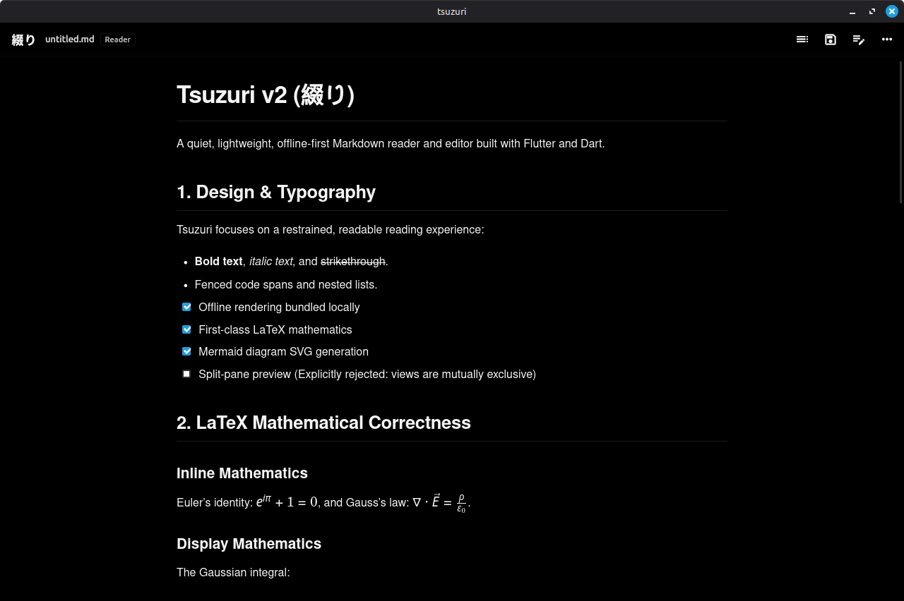
  &nbsp;
  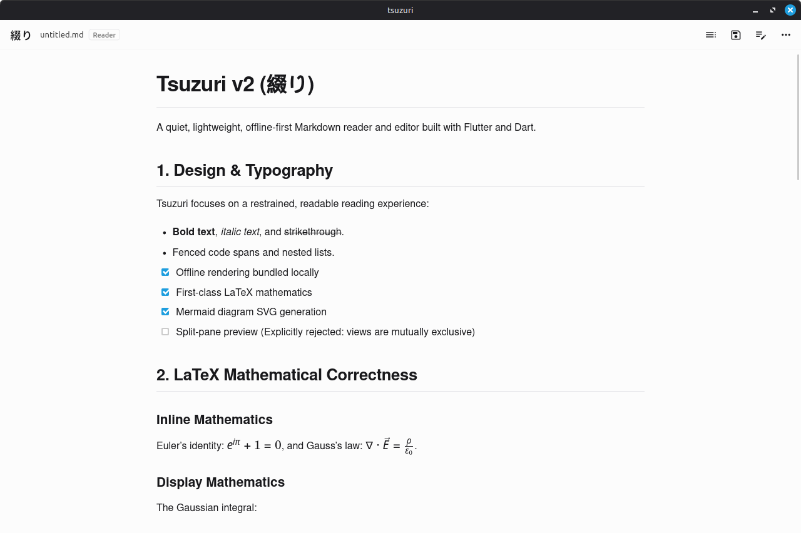
</p>
<p align="center">
  <em>Left: AMOLED Pure Black mode with typeset LaTeX math. Right: High-contrast Light theme.</em>
</p>

### Mobile Hardware Showcase
Typeset mathematics, chemical equations (`\ce{2H2 + O2 -> 2H2O}`), SVG Mermaid diagrams, and structured code cards running 100% offline on mobile hardware (*Realme 1 / Android 9*).

<p align="center">
  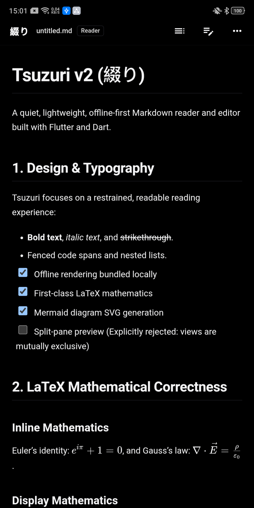
  &nbsp;
  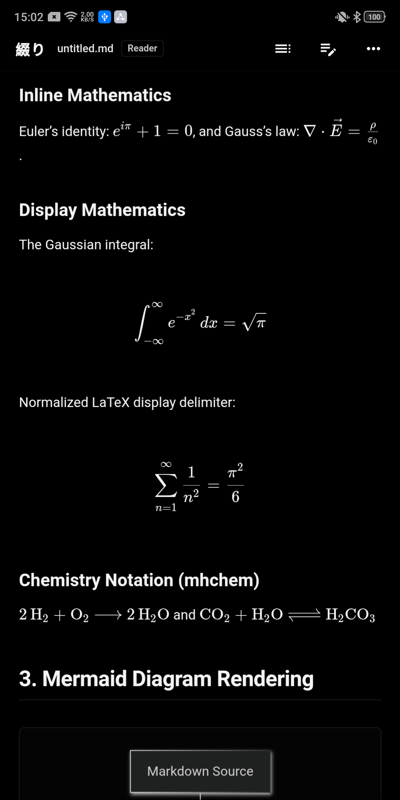
  &nbsp;
  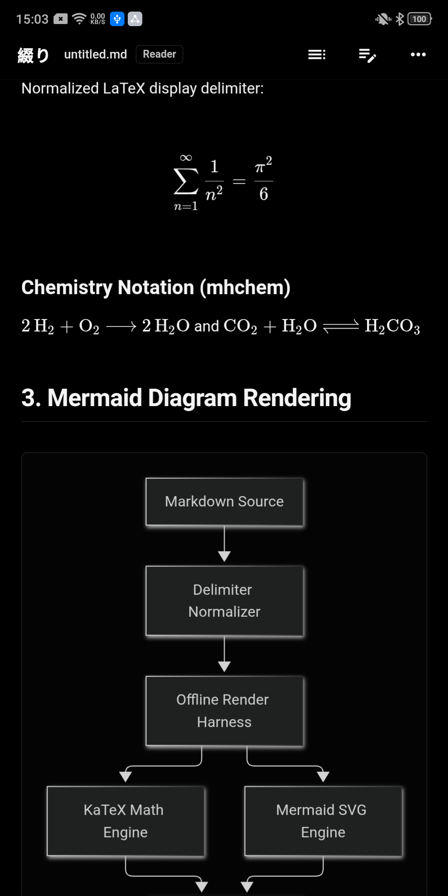
  &nbsp;
  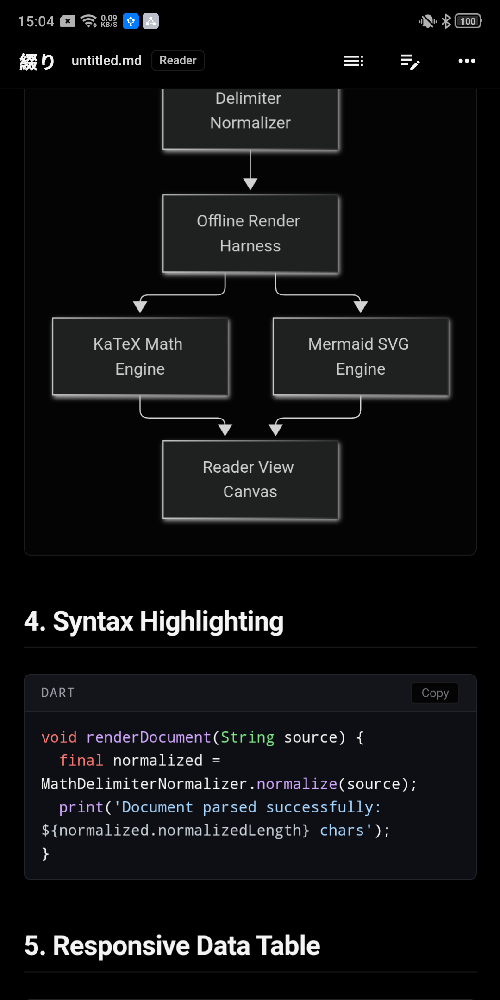
</p>
<p align="center">
  <em>From left to right: (1) AMOLED reading view, (2) typeset chemistry & math, (3) offline Mermaid SVG diagram, (4) syntax-highlighted code block card with copy button.</em>
</p>

### Editor & Adaptive Controls
Monospace editor with synchronized line numbers gutter (zero scrollbars), cursor status bar, integrated Find & Replace (`Ctrl+F`), and anchored desktop popover menu.

<p align="center">
  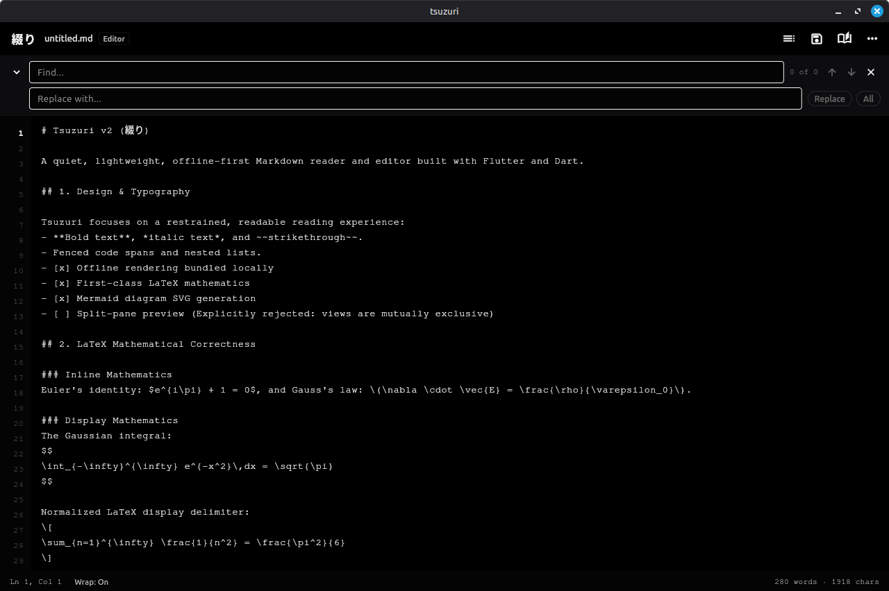
  &nbsp;
  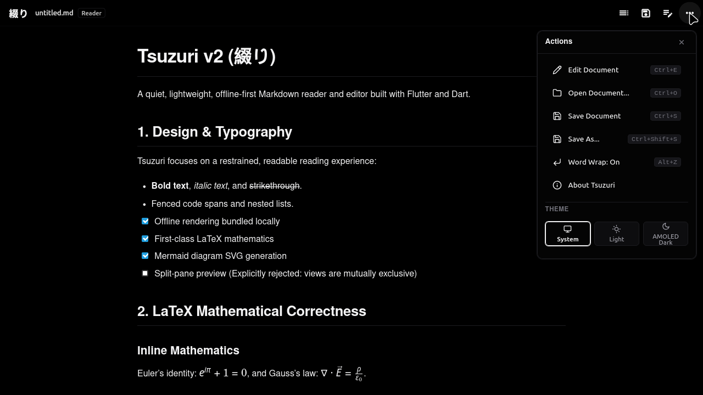
</p>
<p align="center">
  <em>Left: Editor with synchronized gutter and search toolbar. Right: In-webview popover menu over full-width Reader view.</em>
</p>

<details>
<summary><b>📷 Click to view additional screenshots (TOC Drawers, Light Popovers, Mobile Actions)</b></summary>
<br>

<p align="center">
  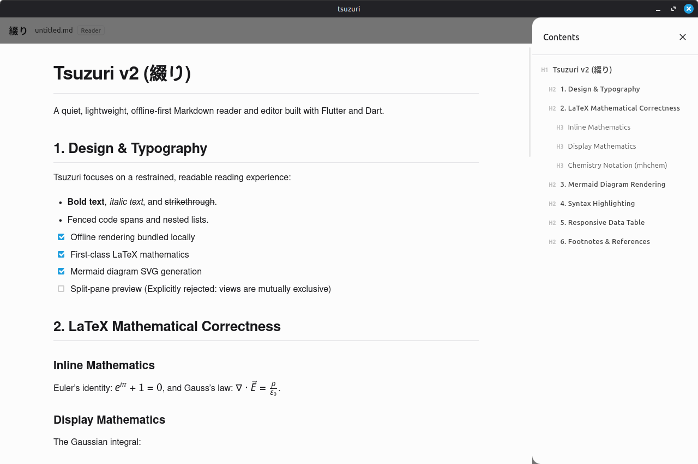
  &nbsp;
  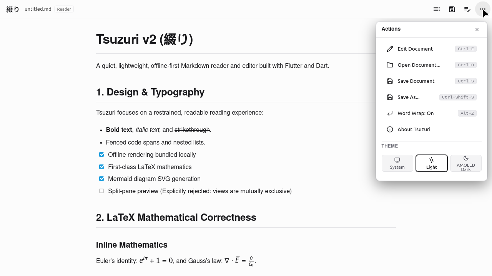
</p>
<p align="center">
  <em>Left: Desktop Table of Contents drawer. Right: Instantaneous light theme switcher popover.</em>
</p>

<p align="center">
  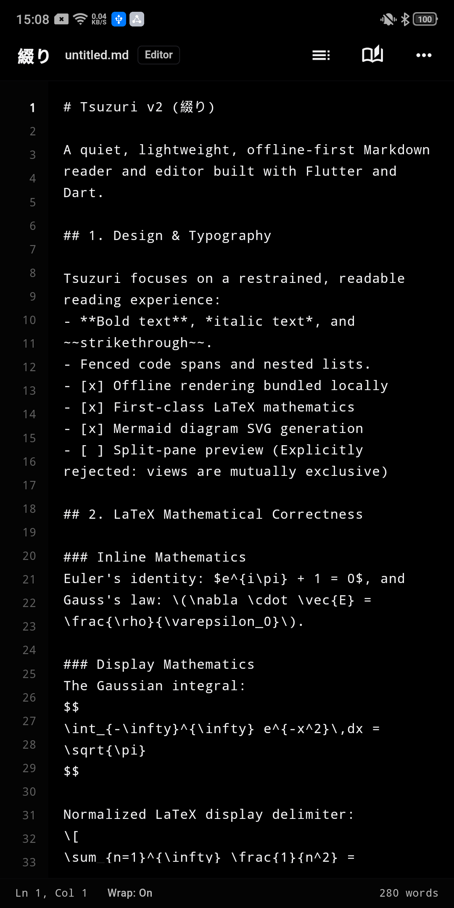
  &nbsp;&nbsp;
  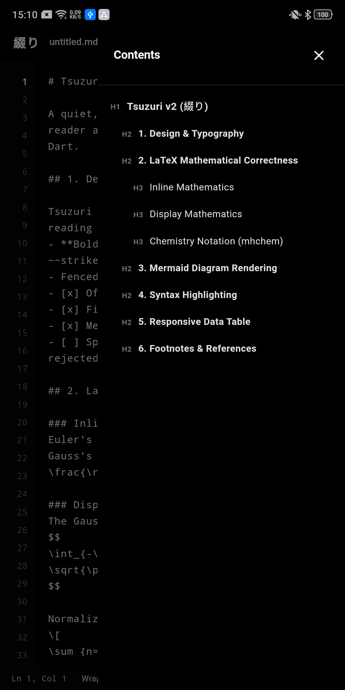
  &nbsp;&nbsp;
  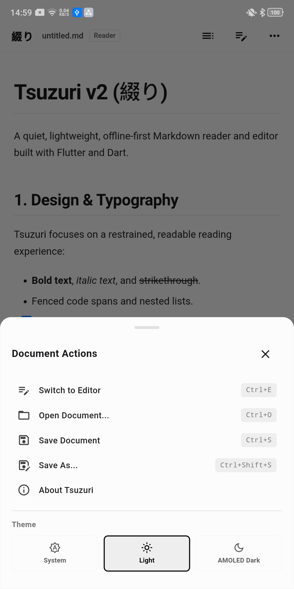
</p>
<p align="center">
  <em>Left: Mobile editor view. Center: Mobile TOC jump drawer. Right: Mobile bottom sheet modal with grab handle.</em>
</p>

</details>

---

## Key Features

- **Mutually Exclusive Reader & Editor Views**: A distraction-free formatted Reader view and a raw Markdown Editor view. Split-pane preview is deliberately avoided to maximize viewport ergonomics across both desktop and mobile screens.
- **First-Class LaTeX Mathematics**: High-performance offline mathematical typesetting via bundled KaTeX for inline expressions (`$...$`, `\(...\)`) and display equations (`$$...$$`, `\[...\]`) with automatic delimiter normalization.
- **Offline Chemistry Notation**: Complete support for `\ce{...}` chemical formulas and `\pu{...}` physical units powered by bundled `mhchem.min.js`.
- **Mermaid Vector SVG Diagrams**: Offline client-side rendering of flowcharts, sequence diagrams, class diagrams, state diagrams, ER diagrams, and git graphs directly to sharp vector SVGs, with friendly error cards and source fallback.
- **Structured Code Block Cards**: Distinguishable code snippet containers featuring an elevated header strip, uppercase language badge, syntax highlighting, and an interactive clipboard copy button.
- **100% Offline-First Architecture**: All rendering resources (`markdown-it`, `mermaid.min.js`, `katex`, `mhchem`, `highlight.js`, styles, fonts) are bundled locally inside application assets. Zero CDN dependencies; zero external network access required.
- **AMOLED Pure Black & Restrained Typography**: Three themes—**System** (default), **Light** (`#fcfcfc` canvas), and **AMOLED Dark** (`#000000` pure black canvas) designed for power efficiency and comfortable reading.
- **Safe Document I/O & Atomic Writes**: External file modifications and unsaved edits are guarded with state checks and user prompts. Atomic disk writes prevent document corruption during unexpected interruptions.
- **Table of Contents (TOC) Navigation**: Fast pure-Dart heading extraction (H1–H6) ignoring code fences, with an interactive jump drawer for seamless navigation.
- **Editor Ergonomics**: Monospace typography, synchronized line numbers gutter with scrollbar suppression, word wrap toggle (`Alt+Z`), status bar (Ln/Col, word count, char count), and inline Find & Replace (`Ctrl+F`).
- **Responsive Layout & Airspace Management**: Viewports $\ge 681$px render an anchored top-right popover dropdown, while viewports $< 681$px display a mobile bottom sheet with grab handle. On Linux desktop, popovers and dialogs render directly in the webview DOM with zero margin reduction and zero content reflow.

---

## Automated Multi-Platform GitHub Workflows

Tsuzuri v2 includes automated GitHub Actions workflows to build, validate, and publish release binaries for every supported platform directly to GitHub Releases, precisely like the original Tsuzuri project:

### 1. Production Release Workflow (`.github/workflows/release.yml`)

Triggered on every version tag push (`v*`, e.g., `v2.0.0`) or manually via **workflow_dispatch**:

| Target Platform | Runner OS | Generated Release Artifacts | Packaging Format |
|---|---|---|---|
| **Linux (x86_64)** | `ubuntu-22.04` | `Tsuzuri_<version>_amd64.deb`<br>`Tsuzuri_<version>_linux-x64.tar.gz` | Debian package (`dpkg-deb`) & standalone binary tarball |
| **Windows (x64)** | `windows-latest` | `Tsuzuri_<version>_windows-x64.zip` | Standalone portable executable archive |
| **macOS (Universal)** | `macos-latest` | `Tsuzuri_<version>_macos.dmg`<br>`Tsuzuri_<version>_macos.zip` | Apple Disk Image (`hdiutil`) & `.app` bundle archive |
| **Android** | `ubuntu-latest` | `Tsuzuri_<version>.apk`<br>`Tsuzuri_<version>.aab` | Signed universal APK (`apksigner`) & Play Store bundle |
| **iOS** | `macos-14` | `Tsuzuri_<version>.ipa` | Ad-hoc / AltStore / Sideloadly unsigned `.ipa` payload |
| **Web Target** | `ubuntu-latest` | `Tsuzuri_<version>_web.zip` | Self-contained static web application archive |

### 2. Mobile CI Build Workflow (`.github/workflows/build-mobile.yml`)

Triggered on pushes and pull requests to `main` and `master`:
- **Builds Android APK**: Compiles debug APK and uploads artifact `tsuzuri-android-apk`.
- **Builds iOS IPA**: Compiles unsigned iOS build on macOS runner and uploads artifact `tsuzuri-ios-payload`.

### How to Publish a New Release

```bash
# 1. Update version tag
git tag v2.0.0

# 2. Push tag to GitHub
git push origin v2.0.0
```

GitHub Actions will spin up Ubuntu, Windows, and macOS runners concurrently, synchronize version metadata via `scripts/sync-version.sh`, compile native binaries for all 6 targets, and publish them to GitHub Releases.

---

## Local Development & Build Commands

### Prerequisites
- **Flutter SDK**: 3.41.9 or later (channel stable)
- **Dart SDK**: 3.11.5 or later
- **Host Dependencies**:
  - Linux: `cmake`, `ninja-build`, `pkg-config`, `libgtk-3-dev`, `webkit2gtk-4.1`
  - Android: Android SDK 37.0.0, API 28+ (Android 9+)
  - macOS / iOS: macOS with Xcode 16+

### Clone Repository
```bash
git clone https://github.com/ameya-deshpande-5056/Tsuzuri-v2.git
cd Tsuzuri-v2
```

### Verification & Testing
```bash
# Static analysis (must report 0 issues)
flutter analyze

# Run full automated test suite (49 unit, widget, and regression tests)
flutter test
```

### Compiling Binaries

#### Linux Desktop
```bash
flutter build linux --release
# Standalone bundle: build/linux/x64/release/bundle/tsuzuri
```

#### Windows Desktop
```bash
flutter build windows --release
# Standalone bundle: build/windows/x64/runner/Release/
```

#### macOS Desktop
```bash
flutter build macos --release
# Application bundle: build/macos/Build/Products/Release/tsuzuri.app
```

#### Android
```bash
# Debug APK
flutter build apk --debug

# Release APK
flutter build apk --release
# Output: build/app/outputs/flutter-apk/app-release.apk

# Android App Bundle (for Google Play)
flutter build appbundle --release
# Output: build/app/outputs/bundle/release/app-release.aab
```

#### iOS
```bash
flutter build ios --release --no-codesign
# Application payload: build/ios/iphoneos/Runner.app
```

#### Web Target
```bash
flutter build web --release
# Output: build/web/
```

---

## Keyboard Shortcuts

| Shortcut | Action | Scope |
|---|---|---|
| `Ctrl+E` / `Cmd+E` | Switch between **Reader** and **Editor** modes | Global |
| `Ctrl+O` / `Cmd+O` | Open Markdown document... | Global |
| `Ctrl+S` / `Cmd+S` | Save current document | Global |
| `Ctrl+Shift+S` / `Cmd+Shift+S` | Save As... | Global |
| `Ctrl+F` / `Cmd+F` | Open Find & Replace toolbar | Editor |
| `Alt+Z` | Toggle Editor Word Wrap (On / Off) | Editor |
| `Escape` | Close Find toolbar / Dismiss Table of Contents | Global |

---

## Project Structure

```
Tsuzuri-v2/
├── .github/
│   └── workflows/
│       ├── release.yml        # Multi-platform release publisher (Linux, Win, Mac, Android, iOS, Web)
│       └── build-mobile.yml   # Mobile CI validation workflow (Android APK & iOS IPA)
├── scripts/
│   ├── sync-version.js        # Cross-platform Node script for version synchronization
│   └── sync-version.sh        # POSIX bash version synchronization script
├── assets/
│   ├── icon/                  # Application icons across platforms (iOS, Android, macOS, Web, Win)
│   ├── renderer/              # Sandboxed offline rendering engine
│   │   ├── template.html      # Sandboxed offline HTML harness & in-webview modal popover
│   │   ├── renderer.css       # Typography tokens, AMOLED styling, and code block cards
│   │   └── vendor/            # Bundled scripts (mermaid, katex, mhchem, highlight, markdown-it)
│   ├── sample/                # Sample Markdown documents and local test images
│   └── screenshots/           # Desktop and mobile visual verification screenshots
├── lib/
│   ├── main.dart              # Application entry point and theme setup
│   └── src/
│       ├── editor/            # Markdown editor, line gutter, find/replace, status bar
│       ├── models/            # DocumentState model & dirty tracker
│       ├── parser/            # MathDelimiterNormalizer & TocParser
│       ├── renderer/          # ReaderView & BundledAssets loader
│       ├── services/          # FileService (atomic I/O) & AssetResolver
│       ├── theme/             # AppTheme (Light & AMOLED Dark #000000)
│       └── ui/                # AppShell, AppHeader, TocDrawer, ActionsSheet, AboutDialog
├── test/                      # Comprehensive unit, widget, and regression test suite
├── AGENTS.md                  # Developer & agent operational directives
├── PROJECT_STATUS.md          # Authoritative progress and active tasks
├── IMPLEMENTATION_PLAN.md     # Phased roadmap with acceptance criteria
├── DECISIONS.md               # Architectural Decision Records (ADRs)
├── KNOWN_ISSUES.md            # Confirmed defects, risks, and limitations
└── pubspec.yaml               # Flutter package configuration and dependencies
```

---

## License

Tsuzuri v2 is licensed under the [GNU General Public License v3.0](LICENSE).
