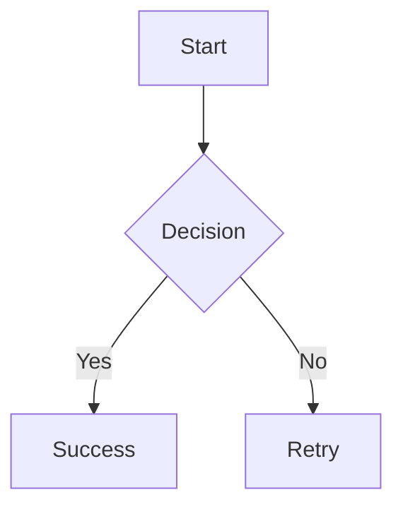

<!-- (```mermaid) -->
# GATE DA: Study Guide Sample

This is a structural excerpt replicating the user-provided guide.

## Section 1: Mermaid Architecture


## Section 2: Code Snippets
```python
def probability(events, sample_space):
    return len(events) / len(sample_space)
```
**Memory hook:** A closing fence must terminate cleanly before this memory hook.

## Section 3: Mathematical Foundations
Bayes theorem for conditional probability:
$$
P(A|B) = \frac{P(B|A) P(A)}{P(B)}
$$

Gaussian integral:
$$
\int_{-\infty}^{\infty} e^{-x^2} dx = \sqrt{\pi}
$$

Inline equations: $X \sim \mathcal{N}(\mu, \sigma^2)$ and variance $\operatorname{Var}(X) = \sigma^2$.

```sql
SELECT student_id, score, DENSE_RANK() OVER (ORDER BY score DESC) AS rank
FROM exam_results;
```
### Chemistry Notation
Reaction: \ce{2H2 + O2 -> 2H2O}
Equilibrium: \ce{CO2 + H2O <=> H2CO3}

